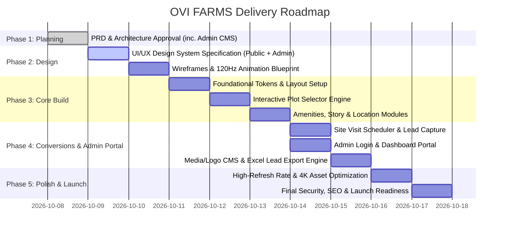

# Product Requirements Document (PRD)
## OVI FARMS — Premium Farmhouse Plots & Managed Farmland Website

---

### Document Control
- **Product Name:** OVI FARMS Digital Experience & Lead Engine
- **Document Version:** v1.0.0
- **Status:** Draft for Review & Baseline Planning
- **Author:** System Architecture & Planning Team
- **Target Audience:** Executive Stakeholders, Marketing Team, Design & Development Teams
- **Date:** October 2026

---

## 1. Executive Summary & Vision

### 1.1 Vision
**OVI FARMS** is an exclusive managed farmland community designed for urban families, nature lovers, and forward-thinking land investors. The vision is to offer premium, clear-title farmhouse plots surrounded by lush organic orchards, world-class club amenities, and 24/7 managed agro-care—combining the tranquility of nature with modern luxury and long-term capital appreciation.

### 1.2 Purpose of the Website
The OVI FARMS website is the primary digital gateway and sales conversion engine. It must:
1. **Differentiate & Inspire:** Establish a premium, trustworthy brand identity ("Luxury Meets Nature").
2. **Educate & Build Confidence:** Address the major friction points of farmland purchasing (clear land titles, water table security, soil fertility, community security, and managed maintenance).
3. **Engage Interactively:** Enable prospective buyers to explore plot configurations, view the interactive master layout, calculate acreage/pricing, and understand amenities.
4. **Drive Qualified Conversions:** Convert high-net-worth individuals (HNIs) and family decision-makers into booked **physical site visits**, brochure downloads, and high-intent WhatsApp inquiries.

---

## 2. Market Problem & Strategic Opportunity

| Urban Pain Points | Traditional Farmland Bottlenecks | OVI FARMS Solution |
| :--- | :--- | :--- |
| **Urban Burnout & Congestion:** City life with pollution, high noise, limited open space for children and seniors. | **Legal Risks & Ambiguity:** Complicated agricultural land laws, disputed titles, lack of clear RERA approvals. | **100% Legally Vetted Plots:** Clear individual demarcation, crystal-clear legal documentation, and verified land registry. |
| **Lack of Green Spaces:** Desire to own land and reconnect with nature without leaving city comforts. | **Maintenance Nightmare:** Remote plots suffer from boundary encroachment, lack of water, weed infestation, and theft. | **Fully Managed Farmland:** Dedicated agronomists and caretakers manage drip irrigation, organic fruit trees, and security 24/7. |
| **Unproductive Capital:** Traditional real estate offers low rental yields and high initial entry barriers. | **Lack of Infrastructure:** Remote plots without roads, electricity, water, or recreational amenities. | **Gated Resort-Style Living:** High-speed internet, blacktop internal roads, clubhouse, pool, solar lighting, and organic harvest share. |

---

## 3. Target Buyer Personas

### Persona A: "The Weekend Recharger" (Dr. Rajiv & Neha, Age 38–48)
- **Profile:** IT VP / Healthcare professional with two kids and aged parents living in an urban high-rise apartment.
- **Motivations:** Needs a private weekend sanctuary within 60–90 minutes drive. Wants their kids to experience open green fields and organic fruit plucking while having access to a swimming pool, clubhouse, and high-speed Wi-Fi.
- **Key Decision Triggers:** Proximity to city, resort amenities, kid-friendly environment, 24/7 security.

### Persona B: "The Green Wealth Investor" (Sameer, Age 42–55)
- **Profile:** Angel investor / Serial entrepreneur seeking portfolio diversification into tangible, appreciating real estate assets.
- **Motivations:** Believes land is the best hedge against inflation. Attracted to managed agro-forestry returns (timber/fruit harvest) and long-term land value appreciation.
- **Key Decision Triggers:** Plot demarcation transparency, ROI projections, surrounding infrastructure growth (upcoming expressways, industrial corridors), and hassle-free management.

### Persona C: "The Serene Retirant" (Col. Sharma & Mrs. Sharma, Age 58–68)
- **Profile:** Retired or nearing retirement couple looking for pollution-free living, pure organic produce, clean groundwater, and a like-minded community.
- **Motivations:** Health, peaceful community, walking trails, meditation gazebos, medical proximity.
- **Key Decision Triggers:** Medical access within 20 mins, pure groundwater, clear titles, level roads, gated perimeter security.

---

## 4. Key Business Goals & Success Metrics (KPIs)

| Objective | Metric / KPI | Target Benchmark |
| :--- | :--- | :--- |
| **Lead Generation** | Site Visit Booking Rate (Visits booked / unique visitors) | $\ge 3.5\%$ conversion |
| **Lead Quality** | High-intent lead capture (Direct phone / WhatsApp enquiries) | $\ge 60\%$ verified phone numbers |
| **Engagement** | Time on page & interactive master layout interaction rate | $\ge 2.5\text{ minutes}$ avg session time |
| **Brand Authority** | Digital brochure / master layout download count | $\ge 150+$ downloads/week |
| **Page Speed & Usability** | Google Lighthouse Performance & Mobile Usability score | $\ge 90+$ on mobile & desktop |

---

## 5. Information Architecture & Site Structure

The platform is structured as an immersive, narrative-driven single-page progressive application (SPA) with dedicated modal deep-dives and standalone legal/brochure resources:

```
OVI FARMS Website
├── Sticky Header (Brand Logo, Navigation Links, Price Highlight, "Book Site Visit" CTA, Direct Call)
│
├── 1. Hero Section (Cinematic Drone Backdrop, Emotional Hook, Key Stats, Dual CTAs)
├── 2. Value Proposition Strip ("Why OVI FARMS" - Clear Titles, Managed Farming, Resort Club, Proximity)
├── 3. The Living Masterplan (Interactive Plot Availability Map & Filter by Acreage/Dimensions)
├── 4. The Farmland Lifestyle & Managed Agro Experience (Organic Orchards, Drip Tech, Farm-to-Table)
├── 5. Resort Amenities & Clubhouse (Infinity Pool, Stargazing Deck, Eco-Cottages, Sports)
├── 6. Strategic Location & Distance Matrix (Interactive Travel Times & Connectivity Hubs)
├── 7. Transparent Pricing & Investment Calculator (Plot Dimensions, Cost Breakdown, Projected Appreciation)
├── 8. Legal Transparency & Trust Center (RERA status, Water & Soil Purity Reports, Registry Process)
├── 9. Visual Gallery & Virtual Drone Tour (Aerial Views, Ground Flora, Community Events)
├── 10. Investor & Buyer Testimonials / Stories (Social Proof from verified early adopters)
├── 11. FAQ Accordion (Common legal, maintenance, construction, and registration questions)
├── 12. Site Visit Booking & Contact Hub (Interactive Scheduler + Pickup Option + Direct WhatsApp)
│
└── Sticky Elements (Floating WhatsApp Quick-Chat + Mobile Quick Call & Book Action Bar)
```

---

## 6. Detailed Functional Requirements (FR)

### FR-1: Hero Section with Cinematic Visuals & Primary CTAs
- **Description:** A visually breathtaking first impression that communicates luxury, tranquility, and prestige.
- **Requirements:**
  - High-impact visual/video background showing rolling green landscape, manicured farm villa, and sunrise over orchards.
  - Value headline: *"Own Your Private Countryside Sanctuary — Managed Farmhouse Plots Designed for Generations."*
  - Quick Credibility Badges: *"100% Clear Title"*, *"24/7 Managed Farming"*, *"60 Mins from City Center"*, *"RERA Compliant"*.
  - Primary CTA: **"Schedule Free Site Visit (With Cab Facility)"** (Opens booking modal).
  - Secondary CTA: **"Explore Master Layout"** (Smooth-scrolls to Interactive Masterplan).

### FR-2: Interactive Master Plan & Plot Availability Explorer
- **Description:** Interactive visual representation of the farmland layout to give buyers complete spatial transparency.
- **Requirements:**
  - Visual layout map displaying individual plots numbered (e.g., Plot #1 to #48).
  - Color-coded plot statuses:
    - **Green:** Available
    - **Amber:** Under Reservation
    - **Charcoal / Gray:** Sold Out
  - Interactive Filter: Filter plots by size category (Quarter-Acre ~ 11,000 sq.ft, Half-Acre ~ 22,000 sq.ft, Full-Acre ~ 44,000 sq.ft) and orientation (East-facing, Lake-view, Orchard-facing).
  - On Plot Hover/Click: Displays interactive popover card with:
    - Plot Number & Dimensions (e.g., *Plot 14 — 10,890 sq.ft / 0.25 Acre*)
    - Included Plantations (e.g., *12 Mango trees, 4 Avocado, 8 Teakwood border trees*)
    - Road frontage & internal road width (e.g., *40 ft wide avenue road*)
    - Pricing / "Request Instant Quote" action button.

### FR-3: Managed Agro-Forestry & Farming Experience Showcase
- **Description:** Details how OVI FARMS takes away the burden of farm maintenance while delivering the joys of farm ownership.
- **Requirements:**
  - 4-pillar showcase:
    1. **Professional Agronomists:** Managed by agricultural scientists ensuring healthy tree growth and pest management.
    2. **Smart Irrigation:** Automated drip irrigation connected to individual plot water points.
    3. **Annual Organic Harvest Share:** Farm-fresh mangoes, papayas, and seasonal greens delivered to the owner’s city residence.
    4. **Eco-Fencing & Dedicated Caretaker:** Live green fencing and round-the-clock physical security.

### FR-4: Resort-Style Amenities & Club Experience
- **Description:** Highlight that OVI FARMS is not just empty land, but an elite countryside community.
- **Requirements:**
  - Visual cards with high-fidelity imagery and feature tags:
    - **The Central Club & Lounge:** Dining hall, co-working green pods, billiards.
    - **Natural Swimming Pool & Spa Deck:** Surrounded by frangipani and date palms.
    - **Stargazing Observatory Deck:** High-powered telescope setup away from city light pollution.
    - **Children's Adventure Park:** Treehouse, obstacle courses, cycling tracks.
    - **Organic Farm Café:** Farm-to-fork dining using produce grown on the premises.
    - **Wellness & Yoga Pavilions:** Shaded bamboo pavilions amidst native flora.

### FR-5: Strategic Location & Connectivity Matrix
- **Description:** Overcomes the objection of "Is it too far?" by highlighting infrastructure connectivity and scenic drive time.
- **Requirements:**
  - Interactive distance calculator and connectivity cards:
    - International Airport / Ring Road: *XX mins via Expressway*
    - Major Tech Hub / Financial District: *XX mins smooth drive*
    - Nearest Multispecialty Hospital: *15 mins*
    - Local Organic Market & Towns: *8 mins*
  - Embedded interactive route guide with Google Maps integration link.

### FR-6: Transparent Pricing & Financial / ROI Calculator
- **Description:** Provide clear, transparent pricing tiers and estimated land appreciation calculations to attract both families and investors.
- **Requirements:**
  - Interactive slider or selector for Plot Size (0.25 Acre, 0.5 Acre, 1.0 Acre).
  - Dynamic breakdown:
    - Land Cost (All-inclusive base price)
    - Infrastructure & Club Membership Fee
    - 3-Year Complimentary Managed Farming & Maintenance
  - Projected Growth / Farmland Appreciation benchmark comparisons vs. urban apartments and gold.
  - Direct CTA: *"Get Detailed Financial Sheet & Payment Plan via WhatsApp"*.

### FR-7: Trust, Legal Integrity & Clear Title Center
- **Description:** Directly answers the highest-risk questions in rural/agricultural land purchasing.
- **Requirements:**
  - Downloadable / Viewable Badges:
    - **100% Mutation & Clear Title Guarantee:** Registered directly in the buyer's name.
    - **Comprehensive Soil Health Card:** High fertility certification for plantation.
    - **Groundwater & Sweet Water Test Report:** Abundant sweet water at certified borewell depth.
    - **Zoning & Land Conversion Compliance:** Legally sanctioned agricultural/farmhouse layout.
    - **Vetted Legal Opinion:** Title opinion documents certified by senior legal counsel.

### FR-8: Site Visit Booking Engine (High-Conversion Lead Magnet)
- **Description:** Frictionless 3-step booking flow to get potential buyers onto the farmland.
- **Requirements:**
  - Simple, modern booking form:
    1. Full Name
    2. Phone Number (with OTP / format validation)
    3. Preferred Date (Interactive calendar with upcoming weekends highlighted)
    4. Preferred Time Slot (Morning 10 AM, Afternoon 2 PM, Sunset 4 PM)
    5. Transportation Preference (Complimentary Chauffeured AC Cab Pickup from City or Self-Drive with GPS link)
  - Immediate instant WhatsApp confirmation message & Calendar invite (.ics).

### FR-9: Digital Brochure & Master Layout Instant Download
- **Description:** Capture mid-funnel prospects who want offline reading material.
- **Requirements:**
  - Minimal popup / inline card: Requires only Name + Phone Number + Email.
  - Automatically delivers high-resolution PDF download link and triggers an automated WhatsApp message with the brochure attachment.

### FR-10: Persistent Contact & Omni-Channel Support
- **Description:** Never let an interested lead leave without an easy way to communicate.
- **Requirements:**
  - Floating WhatsApp icon with pre-filled message: *"Hi OVI FARMS team, I'm interested in knowing more about plot availability and pricing."*
  - Floating "Call Advisor" button on mobile viewports.
  - Comprehensive Footer with full corporate address, RERA registration numbers, disclaimer, and social media handles.

### FR-11: Secure Admin Authentication & Session Management
- **Description:** Dedicated administrative access control to safeguard business data and manage website content.
- **Requirements:**
  - Secure `/admin` route with email/password authentication and persistent session management.
  - Brute-force protection / rate-limiting on login attempts.
  - Secure logout and automatic session expiration on inactivity.
  - Unauthorized redirection protecting all administrative dashboards and data endpoints.

### FR-12: Dynamic Site Identity & Media Management (CMS)
- **Description:** Self-serve content management allowing the admin to update brand assets without developer intervention.
- **Requirements:**
  - **Logo & Branding Control:** Upload/replace business logo (supports SVG, PNG, WebP) with instant live preview and site-wide propagation.
  - **Hero & Background Media Manager:** Ability to update hero video URL/file, background cover imagery, and headline copy.
  - **Photos & Videos Gallery Management:**
    - Upload, replace, categorize, and delete gallery images (Orchards, Farm Villas, Clubhouse, Landscape).
    - Video embeds (Drone footage, walk-through videos, YouTube/Vimeo/direct MP4).
    - Drag-and-drop or order indexing to arrange display priority.
  - **Plot Status Controller:** Quick-toggle plot states (Available, Reserved, Sold) to keep the public masterplan updated in real-time.

### FR-13: Customer Inquiries & Lead Management Dashboard (with Excel Export)
- **Description:** Centralized, real-time log of all customer inquiries, site visit bookings, and brochure requests with export capabilities.
- **Requirements:**
  - **Unified Lead Log Table:**
    - Fields: Timestamp, Name, Phone Number, Email, Type (Site Visit / Brochure / Contact Us), Date/Slot requested, Cab Pickup (Yes/No), Status (New, Contacted, Visit Scheduled, Converted, Archived).
  - **Search & Filtering:** Filter leads by date range, inquiry type, and status; search by customer name or phone number.
  - **Status Updates & Notes:** Admin can mark lead progress and add internal sales notes.
  - **One-Click Excel / CSV Export:**
    - Dedicated **"Export to Excel (.xlsx)"** button.
    - Exports cleanly formatted spreadsheet with all selected columns, formatted dates, and lead details, ready for CRM import or sales team distribution.

---

## 7. Non-Functional Requirements (NFR)

### 7.1 Visual Fidelity & High Refresh Rate (60Hz / 120Hz)
- **Ultra High-Resolution (Retina / 4K Displays):**
  - All icons, logos, and UI graphics rendered via scalable SVGs or high-DPI assets (`@2x`, `@3x`, and responsive `srcset`).
  - Crisp font rendering with subpixel antialiasing (`-webkit-font-smoothing: antialiased`).
- **High Refresh Rate Performance (60fps – 120fps ProMotion):**
  - Smooth animation frame-rate optimized for 60Hz and 120Hz displays (Apple ProMotion, 120Hz+ gaming/workstation monitors).
  - Zero layout thrashing: All micro-interactions and transitions utilize GPU-accelerated CSS properties (`transform: translate3d/scale`, `opacity`, `backdrop-filter`).
  - Passive event listeners for scroll, wheel, and touch events to maintain a locked 60–120 fps scroll velocity without stutter.
  - CSS `will-change` applied strictly to active animating elements to prevent memory bloat while preserving fluid rendering.

### 7.2 Universal Multi-Device Adaptive & Responsive Architecture
The entire platform is engineered to dynamically adapt and optimize its layout, typography, and interactive components across all device form factors:
- **Mobile Phones (320px – 480px):**
  - Mobile-first vertical flow with thumb-friendly touch targets ($\ge 48\text{px}$).
  - Persistent sticky bottom quick-action bar (*"📞 Call Advisor"*, *"💬 WhatsApp"*, *"📅 Book Visit"*).
  - Touch-swipeable image carousels and card sliders with hardware-accelerated momentum scrolling.
  - Collapsible full-screen drawer menu with high-contrast typography.
- **Tablets & Foldables (481px – 1024px - Portrait & Landscape):**
  - Fluid 2-column adaptive layout for amenities, plot filters, and pricing cards.
  - Multi-orientation responsiveness seamlessly transitioning between portrait and landscape.
  - Touch-friendly interactive plot viewer with pinch-to-zoom and pan support.
- **Desktop PCs & Laptops (1025px – 1920px):**
  - Spacious luxury layout with multi-column grids, rich hover micro-interactions, and side-by-side plot layout inspector.
  - Sticky glassmorphic header with instant phone/booking CTAs.
  - Keyboard accessible navigation and interactive cursor states.
- **Ultra-Wide Monitors & Smart TVs / Displays (1920px – 3840px / 4K UHD):**
  - **Smart TV & Presentation Mode:** Legible 10-foot UI design for family viewing in living rooms or investor pitches on large TV screens.
  - **Fluid Fluid-Type & Spacing:** CSS `clamp()` typography and container constraints (`max-width: 1440px`–`1600px`) centered on screen to prevent extreme horizontal stretching and distortion.
  - **High-DPI 4K Clarity:** High-resolution assets and SVG iconography look razor-sharp on 4K/8K displays.
- **Core Web Vitals:** LCP $< 2.0\text{s}$, FID / INP $< 100\text{ms}$, CLS $< 0.05$ across all device tiers.

### 7.3 Accessibility & Usability (WCAG 2.1 AA)
- High contrast ratios ($\ge 4.5:1$) for all typography against nature/earth tone backgrounds.
- Explicit `aria-label` attributes on all interactive plot maps, sliders, and buttons.
- Full keyboard and screen reader accessibility for booking modal workflows.

### 7.4 SEO & Discoverability
- **Semantic HTML5:** Strict single `<h1>`, logical `<h2>`/`<h3>` hierarchy.
- **Structured Schema Markup:**
  - `RealEstateAgent` schema for OVI FARMS business entity.
  - `Place` and `SingleFamilyResidence` / `Landform` schema for plot inventory.
  - `FAQPage` schema for the FAQ section to enable Google rich snippets.
- **OpenGraph & Twitter Card Metadata:** Dynamic social preview image showing lush greenery and branding for link sharing across WhatsApp, LinkedIn, and Facebook.

### 7.5 Data Security & Privacy
- SSL/TLS HTTPS encryption on all connections.
- Form rate-limiting and honeypot spam protection on all lead capture forms.
- Compliant privacy policy detailing safe storage of phone numbers and no third-party data selling.
- Secure, authenticated endpoints for lead retrieval and media management.

---

## 8. Technology Stack & Architecture Guidelines

Based on project requirements and ecosystem standards:
- **Client Web Experience:** Modern Semantic HTML5, Modular CSS3 (Design tokens, Custom Properties, Glassmorphism, 120Hz GPU transitions), and Modular ES6+ JavaScript.
- **Backend & Data Storage:** High-performance lightweight backend (Node.js / Express or Vite server-side API) with JSON / SQLite / persistent data store for:
  - Admin authentication & session verification.
  - Dynamic media and branding configuration store (`site-config.json` / database).
  - Customer leads database with full CRUD and status updates.
- **Excel Export Engine:** Client/Server spreadsheet generation library (e.g., `xlsx` / SheetJS or native CSV/Blob streaming) for instant .xlsx download.
- **Styling Architecture:** Custom Design System adhering to `ui-ux-pro-max` guidelines (Earth luxury palette: Deep Forest Emerald `#0D3B2E`, Muted Terracotta/Gold `#D4AF37` / `#C88A35`, Warm Sand `#FAF7F2`, Slate Charcoal `#1E2421`).
- **Interactive Map:** Scalable SVG Vector Architecture with coordinate hover triggers, or canvas-based layout.
- **Integrations:**
  - WhatsApp Business Click-to-Chat API.
  - Google Maps API / Location embed.

---

## 9. Phased Execution Roadmap



---

## 10. Open Questions & Stakeholder Sign-Off Items

Before proceeding to **Phase 2 (Design System Specification)**, the following key project parameters can be customized or approved with the default recommendations:
1. **Specific Geographic Location & Region:** (e.g., Near Bangalore/Hyderabad/Pune/Mumbai/Delhi-NCR or custom location).
2. **Plot Size Spectrum:** Standard recommendation is 0.25 Acre (10,890 sq.ft), 0.5 Acre (21,780 sq.ft), and 1.0 Acre (43,560 sq.ft).
3. **Price Starting Point / Range:** Display transparent starting price (e.g., "Plots starting from ₹49 Lakhs*") or "Price on Request / Inquire for Plot Tier".
4. **Admin Credentials Initial Setup:** Default initial admin credentials (can be updated via dashboard).

